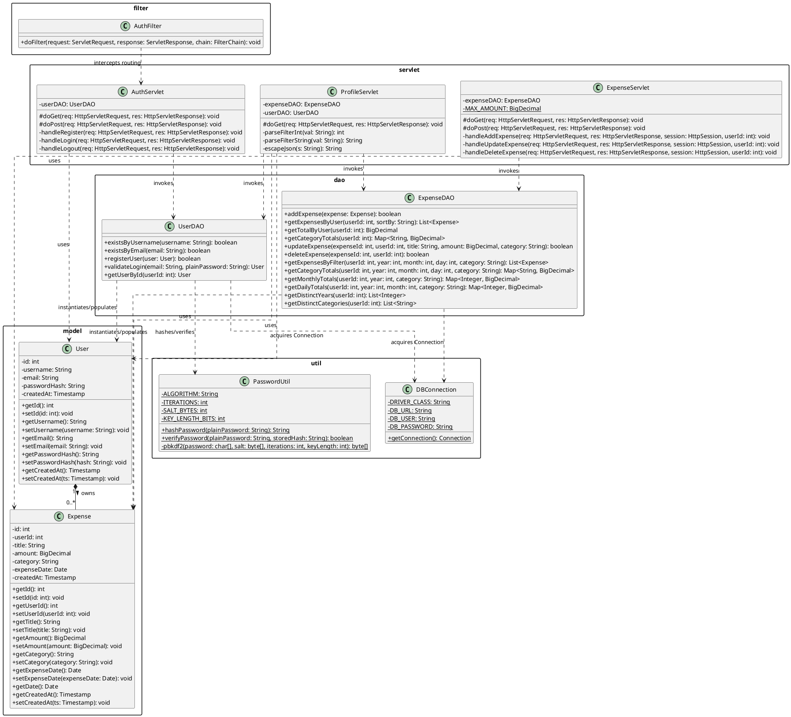
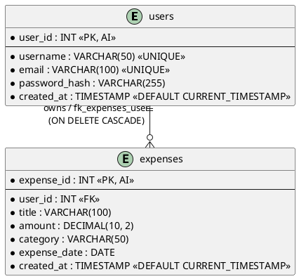
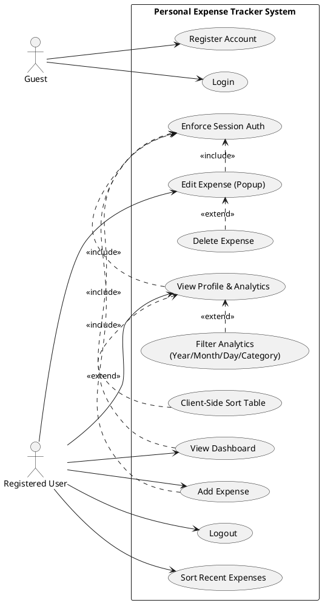
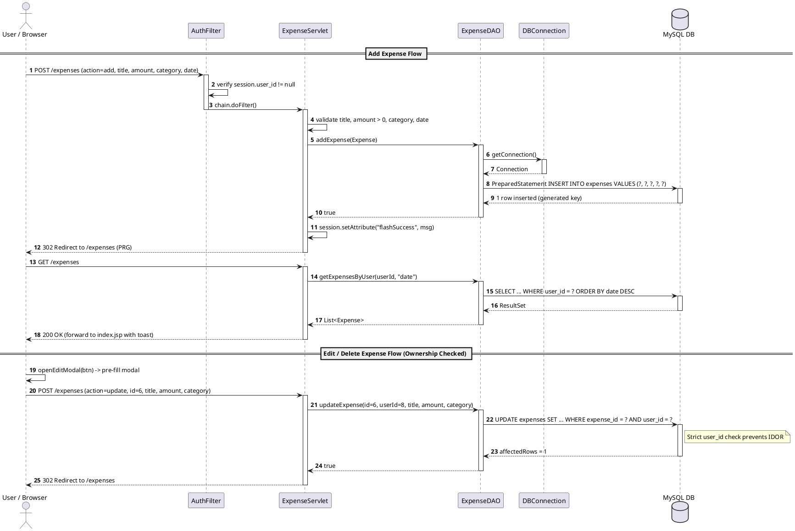
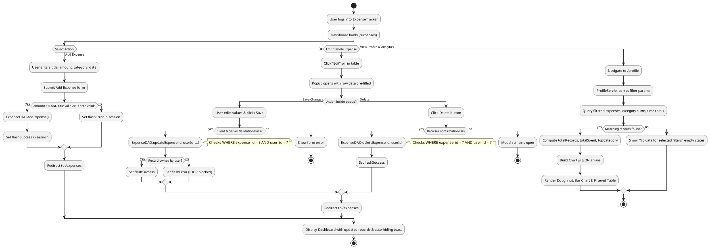

# Technical Architecture & UML Diagram Descriptions

## Project Overview

The **Personal Expense Tracker** is a Java EE web application engineered with Jakarta EE Servlets, JavaServer Pages (JSP), Standard Tag Library (JSTL), and native JDBC using the Data Access Object (DAO) architectural pattern. The system connects to a MySQL 8.x relational database (`expense_tracker_db`) to provide multi-user financial tracking. Key capabilities include cryptographically salted password-based authentication (PBKDF2WithHmacSHA256), a unified dashboard displaying real-time financial summaries, categorized recent transactions, expense creation, an interactive modal-based edit/delete workflow with strict Insecure Direct Object Reference (IDOR) prevention, and an analytics profile interface with multi-dimensional SQL-based filtering (by year, month, day, and category) and dynamic Chart.js data visualizations.

---

## 1. Class Diagram

### Introduction
The Class Diagram visualizes the static structural model of the Personal Expense Tracker application across its architectural tiers: Presentation (Servlets & Filters), Business/Data Access (DAOs), Domain Models (POJOs), and Utilities. It delineates class attributes, operational methods, access scopes, and inter-class relationships enforcing separation of concerns.

### Detailed Description

#### Architectural Layers & Classes

##### 1. Domain Models (`model` package)
* **`User` (`model.User`)**: Represents an authenticated application account.
  * *Attributes*:
    * `- id: int`: Unique identifier (maps to `user_id`).
    * `- username: String`: Unique user handle (max 50 chars).
    * `- email: String`: Unique email address (max 100 chars).
    * `- passwordHash: String`: PBKDF2 formatted hash string (`iterations:salt:hash`).
    * `- createdAt: java.sql.Timestamp`: Account creation timestamp.
  * *Key Methods*:
    * `+ getId(): int`, `+ setId(id: int): void`
    * `+ getUsername(): String`, `+ setUsername(username: String): void`
    * `+ getEmail(): String`, `+ setEmail(email: String): void`
    * `+ getPasswordHash(): String`, `+ setPasswordHash(passwordHash: String): void`
    * `+ getCreatedAt(): java.sql.Timestamp`, `+ setCreatedAt(createdAt: java.sql.Timestamp): void`
  * *Purpose*: Encapsulates user identity and credentials across controller and DAO layers.

* **`Expense` (`model.Expense`)**: Represents an individual financial transaction.
  * *Attributes*:
    * `- id: int`: Primary key (`expense_id`).
    * `- userId: int`: Foreign key referencing the account owner (`user_id`).
    * `- title: String`: Description of the expenditure (max 100 chars).
    * `- amount: java.math.BigDecimal`: Transaction monetary value (DECIMAL 10,2).
    * `- category: String`: Spending classification (e.g., Food, Transport, Utilities).
    * `- expenseDate: java.sql.Date`: Calendar date of the expenditure.
    * `- createdAt: java.sql.Timestamp`: Timestamp when the record was logged.
  * *Key Methods*:
    * `+ getId(): int`, `+ setId(id: int): void`
    * `+ getUserId(): int`, `+ setUserId(userId: int): void`
    * `+ getTitle(): String`, `+ setTitle(title: String): void`
    * `+ getAmount(): java.math.BigDecimal`, `+ setAmount(amount: java.math.BigDecimal): void`
    * `+ getCategory(): String`, `+ setCategory(category: String): void`
    * `+ getExpenseDate(): java.sql.Date`, `+ setExpenseDate(expenseDate: java.sql.Date): void`
    * `+ getDate(): java.sql.Date` *(property alias for JSP expression language)*
    * `+ getCreatedAt(): java.sql.Timestamp`, `+ setCreatedAt(createdAt: java.sql.Timestamp): void`
  * *Purpose*: Encapsulates individual financial transaction state across controller, DAO, and view tiers.

##### 2. Data Access Layer (`dao` package)
* **`UserDAO` (`dao.UserDAO`)**:
  * *Attributes*: None (stateless).
  * *Key Methods*:
    * `+ existsByUsername(username: String): boolean`
    * `+ existsByEmail(email: String): boolean`
    * `+ registerUser(user: User): boolean`
    * `+ validateLogin(email: String, plainPassword: String): User`
    * `+ getUserById(userId: int): User`
  * *Purpose*: Executes parameter-bound SQL queries against the `users` table, utilizing `PasswordUtil` for credential verification and `DBConnection` for connection pooling/lifecycle.

* **`ExpenseDAO` (`dao.ExpenseDAO`)**:
  * *Attributes*: None (stateless).
  * *Key Methods*:
    * `+ addExpense(expense: Expense): boolean`
    * `+ getExpensesByUser(userId: int, sortBy: String): List<Expense>`
    * `+ getTotalByUser(userId: int): java.math.BigDecimal`
    * `+ getCategoryTotals(userId: int): Map<String, BigDecimal>`
    * `+ updateExpense(expenseId: int, userId: int, title: String, amount: BigDecimal, category: String): boolean`
    * `+ deleteExpense(expenseId: int, userId: int): boolean`
    * `+ getExpensesByFilter(userId: int, year: int, month: int, day: int, category: String): List<Expense>`
    * `+ getCategoryTotals(userId: int, year: int, month: int, day: int, category: String): Map<String, BigDecimal>`
    * `+ getMonthlyTotals(userId: int, year: int, category: String): Map<Integer, BigDecimal>`
    * `+ getDailyTotals(userId: int, year: int, month: int, category: String): Map<Integer, BigDecimal>`
    * `+ getDistinctYears(userId: int): List<Integer>`
    * `+ getDistinctCategories(userId: int): List<String>`
  * *Purpose*: Enforces all persistent CRUD operations and aggregated analytical calculations for transactions, strictly scoped by `user_id`.

##### 3. Controller Layer (`servlet` & `filter` packages)
* **`AuthFilter` (`filter.AuthFilter`)**:
  * *Key Methods*:
    * `+ doFilter(request: ServletRequest, response: ServletResponse, chain: FilterChain): void`
  * *Purpose*: Intercepts all incoming requests (`/*`), bypassing static assets and public auth endpoints while redirecting unauthenticated visitors to `login.jsp` and applying HTTP no-cache security headers.

* **`AuthServlet` (`servlet.AuthServlet`)**:
  * *Attributes*:
    * `- userDAO: UserDAO`
  * *Key Methods*:
    * `#doGet(request: HttpServletRequest, response: HttpServletResponse): void`
    * `#doPost(request: HttpServletRequest, response: HttpServletResponse): void`
    * `- handleRegister(request: HttpServletRequest, response: HttpServletResponse): void`
    * `- handleLogin(request: HttpServletRequest, response: HttpServletResponse): void`
    * `- handleLogout(request: HttpServletRequest, response: HttpServletResponse): void`
  * *Purpose*: Coordinates authentication lifecycles including input validation, session creation/invalidation, and session fixation defense via `request.changeSessionId()`.

* **`ExpenseServlet` (`servlet.ExpenseServlet`)**:
  * *Attributes*:
    * `- expenseDAO: ExpenseDAO`
    * `- MAX_AMOUNT: BigDecimal = 99999999.99`
  * *Key Methods*:
    * `#doGet(request: HttpServletRequest, response: HttpServletResponse): void`
    * `#doPost(request: HttpServletRequest, response: HttpServletResponse): void`
    * `- handleAddExpense(request: HttpServletRequest, response: HttpServletResponse, session: HttpSession, userId: int): void`
    * `- handleUpdateExpense(request: HttpServletRequest, response: HttpServletResponse, session: HttpSession, userId: int): void`
    * `- handleDeleteExpense(request: HttpServletRequest, response: HttpServletResponse, session: HttpSession, userId: int): void`
  * *Purpose*: Manages dashboard state population, expense insertion, popup-based updates, and deletion using the Post/Redirect/Get pattern.

* **`ProfileServlet` (`servlet.ProfileServlet`)**:
  * *Attributes*:
    * `- expenseDAO: ExpenseDAO`
    * `- userDAO: UserDAO`
  * *Key Methods*:
    * `#doGet(request: HttpServletRequest, response: HttpServletResponse): void`
    * `- parseFilterInt(val: String): int`
    * `- parseFilterString(val: String): String`
    * `- escapeJson(s: String): String`
  * *Purpose*: Handles the profile and analytics dashboard, extracting filtering parameters, retrieving aggregated metrics from DAOs, formatting JSON payloads for Chart.js, and forwarding to `profile.jsp`.

##### 4. Utility Layer (`util` package)
* **`DBConnection` (`util.DBConnection`)**:
  * *Attributes*:
    * `- DRIVER_CLASS: String = "com.mysql.cj.jdbc.Driver"`
    * `- DB_URL: String`
    * `- DB_USER: String = "root"`
    * `- DB_PASSWORD: String = "gnims"`
  * *Key Methods*:
    * `+ getConnection(): java.sql.Connection`
  * *Purpose*: Factory utility managing the JDBC connection lifecycle to MySQL.

* **`PasswordUtil` (`util.PasswordUtil`)**:
  * *Attributes*:
    * `- ALGORITHM: String = "PBKDF2WithHmacSHA256"`
    * `- ITERATIONS: int = 65536`
    * `- SALT_BYTES: int = 16`
    * `- KEY_LENGTH_BITS: int = 256`
  * *Key Methods*:
    * `+ hashPassword(plainPassword: String): String`
    * `+ verifyPassword(plainPassword: String, storedHash: String): boolean`
    * `- pbkdf2(password: char[], salt: byte[], iterations: int, keyLength: int): byte[]`
  * *Purpose*: Provides cryptographic PBKDF2 salting and constant-time password hash verification.

#### Relationships & Dependencies
1. **Domain Association**: One `User` owns zero to many (`0..*`) `Expense` entities (`User "1" --> "0..*" Expense`).
2. **Controller to DAO Dependency**:
   * `AuthServlet` depends on `UserDAO` (`1 --> 1`).
   * `ExpenseServlet` depends on `ExpenseDAO` (`1 --> 1`).
   * `ProfileServlet` depends on both `ExpenseDAO` and `UserDAO` (`1 --> 1`).
3. **DAO to Utility Dependency**:
   * `UserDAO` and `ExpenseDAO` invoke `DBConnection.getConnection()` to acquire database connections.
   * `UserDAO` invokes `PasswordUtil.hashPassword(...)` and `PasswordUtil.verifyPassword(...)` for credential management.
4. **DAO to Model Usage**:
   * `UserDAO` instantiates and populates `User` instances.
   * `ExpenseDAO` instantiates and populates `Expense` instances.
5. **Servlet to Model Usage**:
   * `ExpenseServlet` creates new `Expense` objects during additions and reads lists of `Expense` objects during dashboard rendering.
   * `ProfileServlet` consumes `User` and `Expense` objects for UI binding.

### PlantUML: Class Diagram

### Summary
The Class Diagram establishes a clean, decoupled 4-tier model where presentation controllers isolate HTTP routing, stateless DAOs encapsulate all JDBC operations with parameter safety, domain models mirror the database schema, and centralized utilities ensure uniform database connectivity and PBKDF2 cryptography.

---

## 2. Entity-Relationship (ER) Diagram

### Introduction
The Entity-Relationship (ER) Diagram specifies the logical and physical schema of the MySQL database (`expense_tracker_db`). It illustrates relational structures, constraints, data types, indexing strategies, and referential integrity rules governing registered user accounts and their associated financial expenditures.

### Detailed Description

#### Entities & Attributes

| Entity (Table) | Attributes | Constraints | PK / FK | Description |
| :--- | :--- | :--- | :--- | :--- |
| **`users`** | `user_id` INT | AUTO_INCREMENT, NOT NULL | **PK** | Surrogate identifier for user accounts. |
| | `username` VARCHAR(50) | NOT NULL, UNIQUE | None | Unique login display name. |
| | `email` VARCHAR(100) | NOT NULL, UNIQUE | None | Unique email address for login. |
| | `password_hash` VARCHAR(255) | NOT NULL | None | Formatted PBKDF2 hash with embedded salt. |
| | `created_at` TIMESTAMP | DEFAULT CURRENT_TIMESTAMP | None | Record creation audit timestamp. |
| **`expenses`** | `expense_id` INT | AUTO_INCREMENT, NOT NULL | **PK** | Surrogate identifier for expense records. |
| | `user_id` INT | NOT NULL | **FK** | References `users(user_id)`. |
| | `title` VARCHAR(100) | NOT NULL | None | Title/name of the expense. |
| | `amount` DECIMAL(10,2) | NOT NULL | None | Monetary amount incurred. |
| | `category` VARCHAR(50) | NOT NULL | None | Spending category name. |
| | `expense_date` DATE | NOT NULL | None | Occurrence date (yyyy-MM-dd). |
| | `created_at` TIMESTAMP | DEFAULT CURRENT_TIMESTAMP | None | Record creation audit timestamp. |

#### Relationships & Integrity Constraints
* **`users` to `expenses` (1 : N)**:
  * **Cardinality**: One `User` can record zero, one, or many `Expenses` (`1 : 0..*`). Each `Expense` must belong to exactly one `User` (`1 : 1`).
  * **Foreign Key**: `fk_expenses_user` on `expenses.user_id` referencing `users.user_id`.
  * **Referential Action**: `ON DELETE CASCADE ON UPDATE CASCADE`. Deleting a user automatically removes all expenses owned by that user, maintaining referential integrity without orphan records.
* **Indexes**:
  * `idx_user_expense_date` on `expenses(user_id, expense_date)`: A composite B-tree index enabling high-performance queries for user-scoped date-range filtering, monthly/daily grouping, and chronological sorting.

#### Normalization Analysis
* **First Normal Form (1NF)**: Satisfied. All columns contain atomic, non-repeating values; each table possesses a defined primary key.
* **Second Normal Form (2NF)**: Satisfied. All non-key attributes are fully functionally dependent on the entire primary key (both tables utilize single-column surrogate keys).
* **Third Normal Form (3NF)**:
  * The schema meets Third Normal Form with one deliberate domain design characteristic: `category` is stored directly as a `VARCHAR(50)` string within `expenses`, rather than having a separate normalized `categories` lookup table.
  * **Design Rationale**: This is standard for lightweight expense tracking applications, as it simplifies query execution by avoiding multi-table joins on high-throughput aggregation queries (such as `GROUP BY category`), while category consistency is enforced via controller-level whitelisting.

### PlantUML: ER Diagram

### Summary
The relational schema comprises two cleanly defined tables linked via a cascading foreign key constraint, enforcing strict data isolation and rapid query performance via a composite index on `(user_id, expense_date)`.

---

## 3. Use Case Diagram

### Introduction
The Use Case Diagram defines the functional scope of the Personal Expense Tracker from the perspective of its external actors. It depicts user interactions with system boundaries, including authentication gates, core transaction management, and analytics operations, along with `<<include>>` and `<<extend>>` behavioral dependencies.

### Detailed Description

#### Actors
1. **Guest (Unauthenticated User)**: An anonymous web visitor accessing the public landing interface.
2. **Registered User (Authenticated User)**: An identified individual with an active, valid HTTP session.

#### Use Cases

1. **Register**:
   * *Actor*: Guest
   * *Description*: Submits username, email, password, and password confirmation to create an account.
   * *Precondition*: User is not logged in; email and username are not duplicates.
   * *Outcome*: Account is persisted with PBKDF2 hash; user is redirected to `login.jsp`.

2. **Login**:
   * *Actor*: Guest
   * *Description*: Submits email and plaintext password to establish an authenticated session.
   * *Precondition*: Account exists in `users` table.
   * *Outcome*: Session ID is regenerated; `user_id`, `username`, and `email` are stored in `HttpSession`; redirected to `/expenses`.

3. **Logout**:
   * *Actor*: Registered User
   * *Description*: Terminates active authentication by invalidating the HTTP session.
   * *Precondition*: User has an active session.
   * *Outcome*: `session.invalidate()` is called; redirected to `login.jsp?logout=true`.

4. **View Dashboard**:
   * *Actor*: Registered User
   * *Description*: Loads `/expenses`, displaying total spending, total count, category breakdown, add expense form, and recent expenses.
   * *Precondition*: Active session.
   * *Outcome*: Aggregates are computed and displayed on `index.jsp`.

5. **Add Expense**:
   * *Actor*: Registered User
   * *Description*: Enters title, amount, category, and date into the Add Expense card.
   * *Precondition*: Valid positive amount, valid date, title <= 100 chars.
   * *Outcome*: Transaction record inserted into `expenses` for `session.user_id`; dashboard reloads with success toast.

6. **Edit Expense**:
   * *Actor*: Registered User
   * *Description*: Clicks the "Edit" button on a table row, opening a client-side modal popup pre-filled with existing values, edits the fields, and submits updates.
   * *Precondition*: Expense belongs to the authenticated user.
   * *Outcome*: Record updated in database; dashboard refreshed via PRG.

7. **Delete Expense**:
   * *Actor*: Registered User
   * *Description*: Clicks "Delete" inside the Edit popup and confirms the browser prompt.
   * *Precondition*: User is viewing the Edit popup for an expense they own.
   * *Outcome*: Expense removed from database; dashboard refreshed.

8. **Sort Recent Expenses**:
   * *Actor*: Registered User
   * *Description*: Clicks Date, Amount, or Category sort pills on the dashboard to order transactions.
   * *Precondition*: Dashboard is loaded.
   * *Outcome*: `ExpenseDAO` re-queries with the whitelisted sort order.

9. **View Profile & Analytics**:
   * *Actor*: Registered User
   * *Description*: Navigates to `/profile` to view account details, spending metrics, and default charts.
   * *Precondition*: Active session.
   * *Outcome*: `profile.jsp` renders with user details, summary stats, doughnut chart, bar chart, and table.

10. **Filter Analytics (Year, Month, Day, Category)**:
    * *Actor*: Registered User
    * *Description*: Selects combination of dropdown filters and clicks "Apply" (or "Reset" to clear).
    * *Precondition*: User is on the Profile page.
    * *Outcome*: Profile stats, both charts, and table dynamically refresh matching the SQL filter criteria.

11. **Sort Analytics Table (Client-Side)**:
    * *Actor*: Registered User
    * *Description*: Clicks on table header columns (Date, Title, Category, Amount) to toggle ascending/descending order.
    * *Precondition*: Filtered expenses table is rendered.
    * *Outcome*: Table rows re-order immediately in the browser.

#### Relationship Specifications
* **`<<include>>` Relationships**:
  * Every authenticated use case (*View Dashboard, Add Expense, Edit Expense, Delete Expense, View Profile, Filter Analytics*) `<<include>>` the **Check Session Authentication** use case implemented via `AuthFilter`.
* **`<<extend>>` Relationships**:
  * **Delete Expense** `<<extend>>` **Edit Expense**: The delete operation is triggered from within the opened Edit Expense modal dialog.
  * **Filter Analytics** `<<extend>>` **View Profile & Analytics**: Filtering conditionally modifies the standard analytics view.

### PlantUML: Use Case Diagram

### Summary
The Use Case model clearly distinguishes between anonymous onboarding flows and protected financial operations, tying every core CRUD and analytical activity to mandatory session verification.

---

## 4. Sequence Diagram

### Introduction
The Sequence Diagrams trace the precise runtime call chains and chronological message exchanges between browser components, servlet controllers, data access objects, and the database across the application's primary execution paths.

### Detailed Description

#### a) Login Flow
1. **Browser** sends HTTP POST to `/auth` with parameters `action=login`, `email`, and `password`.
2. **`AuthFilter`** intercepts request, determines path is public (`/auth`), and passes through via `chain.doFilter()`.
3. **`AuthServlet.doPost()`** receives the request and delegates to `handleLogin()`.
4. **`AuthServlet`** validates that `email` and `password` parameters are non-empty.
5. **`AuthServlet`** calls `UserDAO.validateLogin(email, password)`.
6. **`UserDAO`** acquires `Connection` from `DBConnection.getConnection()`.
7. **`UserDAO`** executes `SELECT user_id, username, email, password_hash FROM users WHERE LOWER(email) = LOWER(?)` with `PreparedStatement`.
8. **`MySQL DB`** returns matching user record.
9. **`UserDAO`** calls `PasswordUtil.verifyPassword(password, storedHash)`.
10. **`PasswordUtil`** computes PBKDF2 hash of input with stored salt and performs constant-time comparison, returning `true`.
11. **`UserDAO`** returns populated `User` model (with `passwordHash` omitted) to `AuthServlet`.
12. **`AuthServlet`** invalidates previous session and calls `req.changeSessionId()` (session fixation defense).
13. **`AuthServlet`** sets session attributes: `user_id`, `username`, `email`.
14. **`AuthServlet`** issues HTTP 302 Redirect to `/expenses`.
15. **Browser** issues GET `/expenses` to load the dashboard.
* *Alternative Branch (Invalid Credentials)*: If user not found or hash verification fails, `AuthServlet` sets `errorMessage = "Invalid email or password."` and forwards to `login.jsp`.

#### b) Add Expense Flow
1. **Browser** submits POST `/expenses` with `action=add`, `title`, `amount`, `category`, and `expenseDate`.
2. **`AuthFilter`** verifies `session.getAttribute("user_id") != null` and proceeds.
3. **`ExpenseServlet.doPost()`** delegates to `handleAddExpense()`.
4. **`ExpenseServlet`** reads `user_id` from session.
5. **`ExpenseServlet`** performs server-side validation: title not empty and <= 100 chars, amount parseable and > 0, category not empty, date valid `yyyy-MM-dd`.
6. **`ExpenseServlet`** constructs `Expense` instance.
7. **`ExpenseServlet`** invokes `ExpenseDAO.addExpense(expense)`.
8. **`ExpenseDAO`** acquires connection from `DBConnection`.
9. **`ExpenseDAO`** prepares `INSERT INTO expenses (user_id, title, amount, category, expense_date) VALUES (?, ?, ?, ?, ?)`.
10. **`MySQL DB`** inserts record and returns generated `expense_id`.
11. **`ExpenseDAO`** returns `true` to `ExpenseServlet`.
12. **`ExpenseServlet`** stores `flashSuccess = "Expense '...' added successfully!"` in session.
13. **`ExpenseServlet`** issues HTTP 302 Redirect to `/expenses` (Post/Redirect/Get).
14. **Browser** issues GET `/expenses`.
15. **`ExpenseServlet.doGet()`** retrieves updated expenses, total, and category summary, sets them as request attributes, transfers flash message to request, and forwards to `index.jsp`.

#### c) Edit & Delete Expense Flow (with Ownership Verification)
1. **User** clicks `.btn-edit` in `index.jsp` table. Client-side JavaScript (`openEditModal`) reads `data-*` attributes and opens `#editModal` dialog pre-filled with values.
2. *Path C1: Save Changes*:
   1. User updates values and submits `#editForm` (POST `/expenses` with `action=update`, `id`, `title`, `amount`, `category`).
   2. `ExpenseServlet.doPost()` routes to `handleUpdateExpense()`.
   3. `ExpenseServlet` fetches `user_id` from session.
   4. `ExpenseServlet` calls `ExpenseDAO.updateExpense(id, userId, title, amount, category)`.
   5. `ExpenseDAO` prepares SQL: `UPDATE expenses SET title = ?, amount = ?, category = ? WHERE expense_id = ? AND user_id = ?`.
   6. `MySQL DB` updates record ONLY if both `expense_id` AND `user_id` match, returning affected rows count.
   7. `ExpenseDAO` returns `affectedRows > 0`.
   8. `ExpenseServlet` sets `flashSuccess` and redirects (PRG) to `/expenses`.
3. *Path C2: Delete Expense*:
   1. User clicks `#editDeleteBtn` inside the popup.
   2. JavaScript shows `confirm("Delete this expense?")`.
   3. On OK, JavaScript submits `#deleteFromModalForm` (POST `/expenses` with `action=delete`, `id`).
   4. `ExpenseServlet.doPost()` routes to `handleDeleteExpense()`.
   5. `ExpenseServlet` calls `ExpenseDAO.deleteExpense(id, userId)`.
   6. `ExpenseDAO` executes `DELETE FROM expenses WHERE expense_id = ? AND user_id = ?`.
   7. `MySQL DB` deletes row and returns affected rows.
   8. `ExpenseServlet` sets `flashSuccess` and redirects to `/expenses`.

#### d) Load Profile Page with Filters Flow
1. **Browser** issues GET to `/profile?year=2026&month=11&day=9&category=Food`.
2. **`AuthFilter`** verifies active session and passes request through.
3. **`ProfileServlet.doGet()`** extracts `userId` from session.
4. **`ProfileServlet`** parses optional filter parameters: `year`, `month`, `day`, `category` (treating `""` and `"all"` as unrestricted).
5. **`ProfileServlet`** calls:
   * `UserDAO.getUserById(userId)` $\rightarrow$ returns `User` (username, email).
   * `ExpenseDAO.getExpensesByFilter(userId, year, month, day, category)` $\rightarrow$ returns filtered `List<Expense>`.
   * `ExpenseDAO.getCategoryTotals(userId, year, month, day, category)` $\rightarrow$ returns `Map<String, BigDecimal>`.
   * `ExpenseDAO.getMonthlyTotals(userId, year, category)` or `getDailyTotals(...)` $\rightarrow$ returns timeline aggregates.
   * `ExpenseDAO.getDistinctYears(userId)` and `getDistinctCategories(userId)` $\rightarrow$ returns dropdown option lists.
6. **`ProfileServlet`** calculates totals: `totalRecords`, `totalSpent`, `topCategory`.
7. **`ProfileServlet`** constructs JSON string arrays for categories and time periods.
8. **`ProfileServlet`** sets all values as request attributes and forwards to `profile.jsp`.
9. **`profile.jsp`** renders HTML with JSTL, and embedded scripts initialize Chart.js doughnut and bar charts using the injected JSON.

### PlantUML: Sequence Diagram (Combined Critical Flows)

### Summary
The Sequence Diagrams demonstrate complete controller-mediated lifecycles where client submissions are strictly validated, sessions are enforced via intercepting filters, and database operations execute through parametrized DAO calls preventing both SQL injection and unauthorized data access.

---

## 5. Activity Diagram

### Introduction
The Activity Diagrams illustrate the dynamic procedural workflows and business logic control flows of the application. They articulate start states, operational actions, decision diamonds, parallel processing, and terminal states across all major user features.

### Detailed Description

#### a) User Registration and Login Activity
* **Precondition**: Guest arrives at application.
* **Workflow Steps**:
  1. User selects "Create an Account" or "Sign In".
  2. *Registration Branch*:
     * Submits username, email, password, and confirm password.
     * Client-side validation runs in `validation.js` (length checks, email pattern, matching passwords).
     * `AuthServlet` performs duplicate checks (`existsByUsername`, `existsByEmail`).
     * If duplicate exists, display error message on `register.jsp`.
     * If valid, `PasswordUtil.hashPassword()` creates PBKDF2 salt and hash.
     * `UserDAO.registerUser()` writes record to MySQL.
     * System stores success notification and redirects to `login.jsp`.
  3. *Login Branch*:
     * User enters email and password on `login.jsp`.
     * `AuthServlet` queries user by email via `UserDAO.validateLogin()`.
     * If user does not exist $\rightarrow$ Display "Invalid email or password."
     * If user exists, `PasswordUtil.verifyPassword()` computes hash and compares.
     * If hash mismatch $\rightarrow$ Display "Invalid email or password."
     * If valid $\rightarrow$ Invalidate prior session, call `request.changeSessionId()`, bind `user_id`, `username`, and `email` to session, redirect to `/expenses`.

#### b) Add, Edit, and Delete Expense Activity
* **Precondition**: User is authenticated.
* **Workflow Steps**:
  1. User is on dashboard (`index.jsp`).
  2. *Add Action*:
     * User fills title, amount, category, and date.
     * Submits form; `ExpenseServlet` checks: is `amount > 0` and `<= 99999999.99`? Is title valid? Is category selected?
     * If validation fails $\rightarrow$ Set `flashError`, redirect to dashboard.
     * If validation passes $\rightarrow$ Insert via `ExpenseDAO.addExpense()`, set `flashSuccess`, redirect to dashboard.
  3. *Edit Action*:
     * User clicks "Edit" pill button on a row in Recent Expenses table.
     * Client opens modal popup pre-filling form inputs and focuses amount input.
     * User edits values and clicks "Save Changes".
     * Client and server validate field formats.
     * `ExpenseDAO.updateExpense()` executes SQL with `WHERE expense_id = ? AND user_id = ?`.
     * If record belongs to user $\rightarrow$ 1 row updated, set `flashSuccess`, redirect to dashboard.
     * If ownership mismatch $\rightarrow$ 0 rows updated, set `flashError`, redirect to dashboard.
  4. *Delete Action*:
     * Inside modal popup, user clicks "Delete".
     * Browser displays confirmation dialog (`confirm()`).
     * If user cancels $\rightarrow$ Modal remains open.
     * If user confirms $\rightarrow$ Submit hidden form to `/expenses` with `action=delete`.
     * `ExpenseDAO.deleteExpense()` executes SQL with `WHERE expense_id = ? AND user_id = ?`.
     * Set `flashSuccess`, redirect to dashboard.

#### c) View & Filter Analytics on Profile Page Activity
* **Precondition**: User is authenticated and navigates to `/profile`.
* **Workflow Steps**:
  1. `ProfileServlet` receives request and extracts filter parameters (`year`, `month`, `day`, `category`).
  2. Decision: Are filters specified?
     * *No (Default)*: Query all expenses for `session.user_id`. Retrieve distinct years and categories. Aggregate monthly totals (Jan–Dec).
     * *Yes*: Build dynamic SQL query appending `AND YEAR(expense_date) = ?`, `AND MONTH(...) = ?`, etc., binding parameters safely. If a specific month is selected, query daily aggregates (1–31).
  3. Decision: Did query return expense records?
     * *Yes*: Calculate `totalRecords`, `totalSpent`, and determine `topCategory`. Serialize categories and sums to JSON. Render doughnut and bar charts via Chart.js; render table rows with sortable headers.
     * *No*: Set `totalRecords = 0`, `totalSpent = 0.00`, `topCategory = "-"`. Display centered empty states ("No data for selected filters" / "No expenses match your filters").
  4. User interactions:
     * User can click "Reset" to clear all parameters.
     * User can click column headers in the table to execute client-side sorting without server re-queries.

### PlantUML: Activity Diagram (Expense Lifecycle & Analytics)

### Summary
The Activity Diagrams chart the complete operational lifecycle of transactions from data entry, client/server validation, and ownership verification through to aggregated multi-dimensional reporting on the analytics profile view.

---

## Assumptions

1. **Category Model**: As reflected in `schema.sql`, `expenses.category` is stored directly as a `VARCHAR(50)` text field rather than a foreign-key normalized table. Controlled category vocabulary (`Food`, `Transport`, `Housing`, `Utilities`, `Entertainment`, `Healthcare`, `Shopping`, `Education`, `Other`) is enforced through HTML select options and servlet validation.
2. **Container Security & Runtime**: The application assumes deployment on a Jakarta EE 10+ compliant servlet container (Apache Tomcat 11.0.x) supporting Jakarta EE Servlet 6.0 specifications, running on Java SE 17 or higher.
3. **Database Engine**: All SQL date functions (`YEAR()`, `MONTH()`, `DAY()`) and connection strings are configured for MySQL 8.x.
4. **Session State**: User identity is tracked via container-managed HTTP sessions stored in cookies; no secondary persistent token store (such as Redis or JWT) is implemented.

---

## Verification Checklist

- [x] **Model Layer**: `model.User` and `model.Expense` attributes and methods match source code exactly.
- [x] **DAO Layer**: `dao.UserDAO` and `dao.ExpenseDAO` method signatures and PreparedStatement queries match source code exactly.
- [x] **Controller Layer**: `servlet.AuthServlet`, `servlet.ExpenseServlet`, `servlet.ProfileServlet`, and `filter.AuthFilter` reflect actual routing and logic.
- [x] **Utility Layer**: `util.DBConnection` and `util.PasswordUtil` reflect exact encryption parameters and JDBC configuration.
- [x] **Database Schema**: Schema tables (`users`, `expenses`), constraints (`ON DELETE CASCADE`), types (`DECIMAL(10,2)`, `DATE`), and indexes match `schema.sql`.
- [x] **Security Constraints**: Ownership checks (`WHERE expense_id = ? AND user_id = ?`) and PBKDF2 password hashing accurately documented.
- [x] **All 5 UML Diagrams Covered**: Class, ER, Use Case, Sequence, and Activity diagrams fully described and complemented with syntactically valid PlantUML diagram-as-code blocks.
- [x] **Zero File Regressions**: No existing project source code files were modified.
